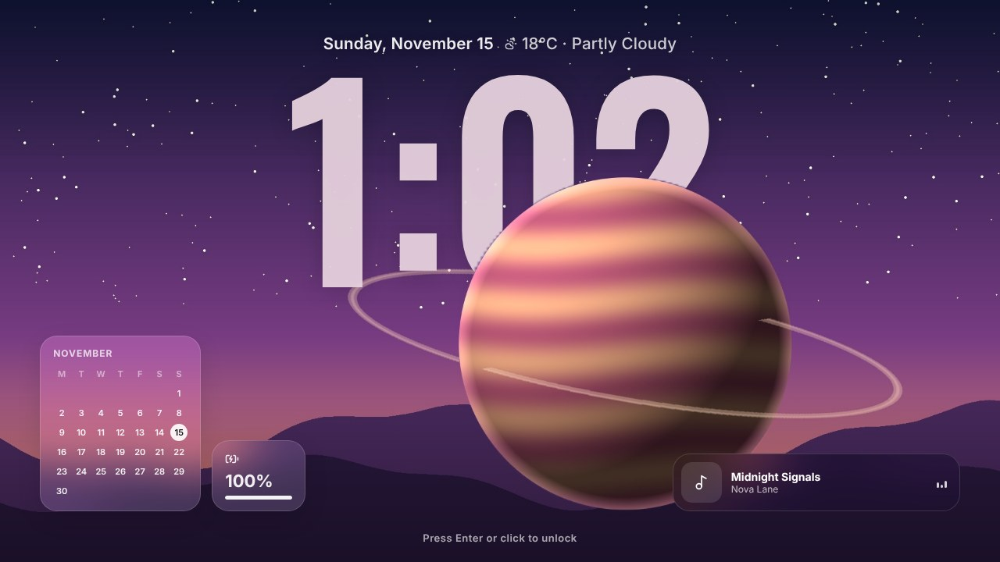
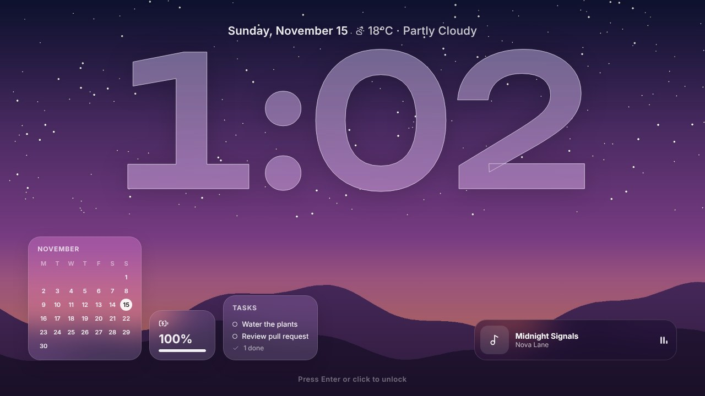
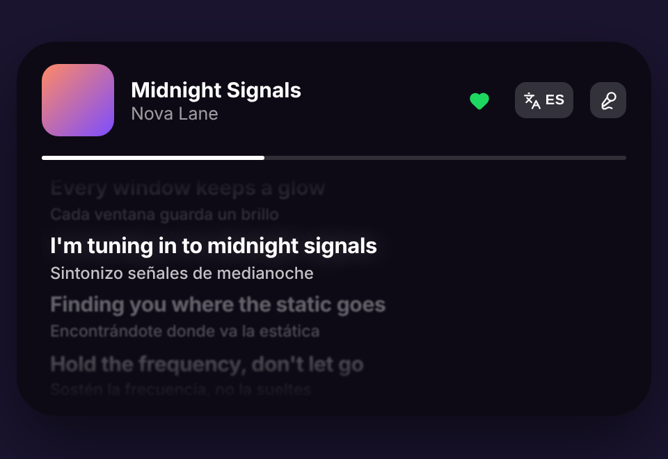
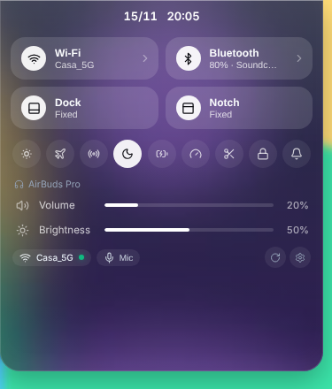
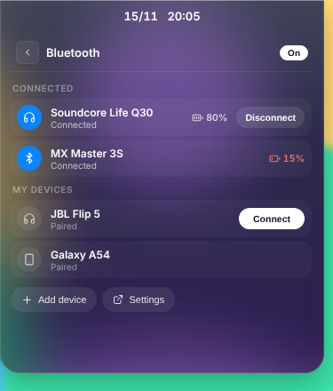
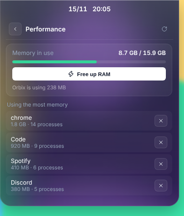
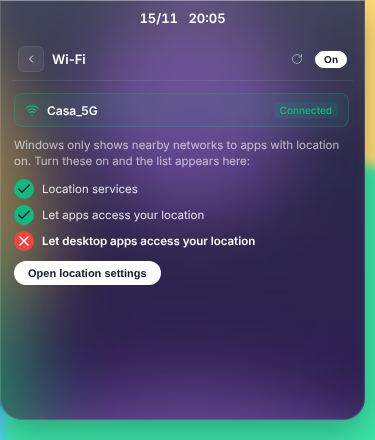
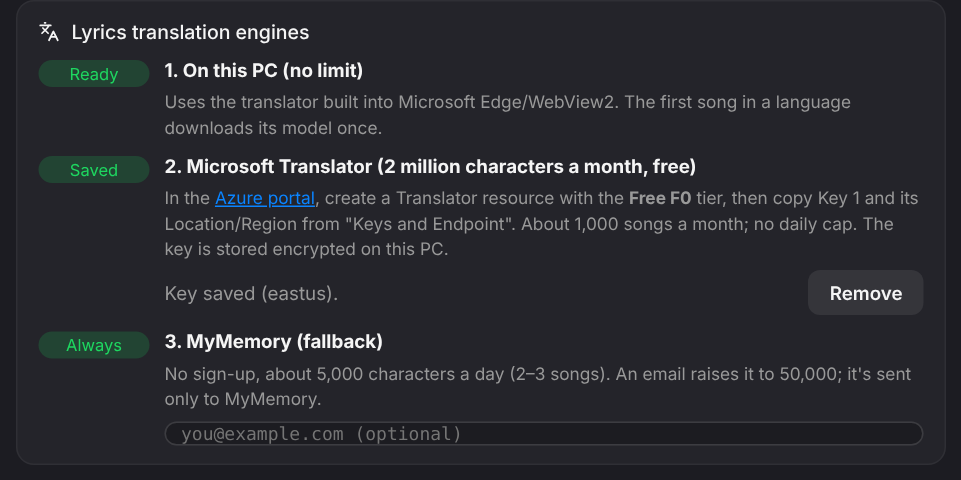
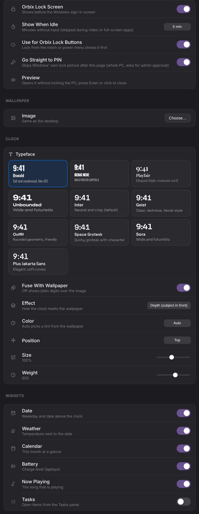
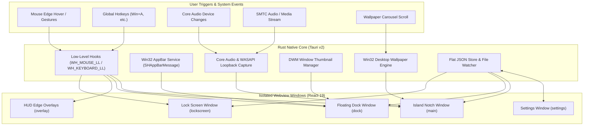

<div align="center">


# Orbix

**Dynamic Island Notch & Floating Physics Dock for Windows**

<sub>This is <a href="https://github.com/Haise-IDK7/Orbix">Haise-IDK7/Orbix</a>, a fork of <a href="https://github.com/Lukog10/Orbix">Lukog10/Orbix</a> with a custom lock screen, synced and translated lyrics, Bluetooth device controls, a Spotify like button, and more. See <a href="#whats-new-in-this-fork">What's New</a>.</sub>

<p align="center">
  <em>An open-source, local-first desktop utility transforming the Windows desktop with spring-physics motion, an adaptive dynamic notch, and a customizable floating taskbar dock.</em>
</p>

[-0078D6?style=for-the-badge&logo=windows&logoColor=white)](https://www.microsoft.com/windows)
[](https://tauri.app/)
[](https://www.rust-lang.org/)
[](https://react.dev/)
[](https://www.framer.com/motion/)
[](https://learn.microsoft.com/en-us/windows/win32/coreaudio/core-audio-apis-in-windows-vista)
[](https://github.com/Haise-IDK7/Orbix/releases/tag/preview)
[](LICENSE)

<br />

[Overview](#overview) &bull; [What's New](#whats-new-in-this-fork) &bull; [Core Features and Subsystems](#core-features-and-subsystems) &bull; [Visual Showcase](#visual-showcase) &bull; [System Architecture](#system-architecture) &bull; [Security and Windows Defender](#security-and-windows-defender) &bull; [Download](#download) &bull; [Building From Source](#building-from-source) &bull; [Repository Structure](#repository-structure) &bull; [License](#license)

<br />


</div>

---

## Overview

**Orbix** is a modern, physics-driven desktop replacement shell for Windows 10 and 11. Built with **Rust (Tauri v2)** and **React 19 / TypeScript**, Orbix replaces the traditional static Windows taskbar with a fluid, floating dock and introduces an adaptive, spring-animated island notch at the top of your display.

Every transition in Orbix is calculated via real-time physics simulations. Whether expanding the notch for quick system toggles, browsing high-resolution wallpapers in the panoramic carousel, triggering safe power actions, previewing running windows on the dock, controlling playback with live WASAPI audio visualizers, or managing Pomodoro focus sessions, Orbix delivers a refined, tactile computing experience without sacrificing performance or battery life.

### Why Orbix?

The standard Windows desktop shell has remained largely static for decades:
1. **Clunky Native Controls**: Quick toggles, power actions, and task switching require navigating separate flyouts, start menus, and hidden taskbar icons.
2. **Heavyweight Shell Replacements**: Many existing desktop customization tools consume substantial CPU and RAM, poll inefficiently, or trigger continuous GPU activity.
3. **Telemetry & Privacy Concerns**: Proprietary desktop enhancements often bundle analytics trackers, background telemetry agents, or forced online accounts.

**Orbix solves this with a modern, lightweight philosophy:**
- **Zero Telemetry, Local-First**: No analytics pings and no account. All configuration is stored locally in clean JSON. The few online features (weather, lyrics, lyric translation, Spotify likes) only talk to the service they need, and only when you use them; see [Network Use](#network-use).
- **Genuine Win32 Integration**: Uses native Win32 `AppBar` registration so maximized windows respect the dock layout, along with DWM thumbnail capture for fluid live previews.
- **Micro-Engineered Efficiency**: Rust-powered background workers sleep when idle. The WASAPI audio visualizer automatically suspends during playback pauses, and mouse-edge triggers dynamically relax outside interaction zones.
- **Natural Physics Animation**: Powered by Framer Motion springs and custom math curves, ensuring every gesture, hover, and dismiss feels alive.

---

## What's New in This Fork

<table>
  <tr>
    <td width="50%" align="center">
      
      <br /><strong>Lock screen · Depth</strong><br /><sub>The wallpaper's subject drawn in front of the clock</sub>
    </td>
    <td width="50%" align="center">
      
      <br /><strong>Lock screen · Frosted glass</strong><br /><sub>Calendar, battery, tasks and now-playing widgets</sub>
    </td>
  </tr>
  <tr>
    <td align="center">
      
      <br /><strong>Synced lyrics + translation</strong><br /><sub>One translated line under each lyric, plus the Spotify like button</sub>
    </td>
    <td align="center">
      
      <br /><strong>Minimal control center</strong><br /><sub>Wi-Fi network and Bluetooth device right on the tiles</sub>
    </td>
  </tr>
  <tr>
    <td align="center">
      
      <br /><strong>Bluetooth devices</strong><br /><sub>Battery level, connect/disconnect for headphones and speakers</sub>
    </td>
    <td align="center">
      
      <br /><strong>Performance</strong><br /><sub>RAM in use, free up RAM, heaviest apps, Orbix's own memory</sub>
    </td>
  </tr>
  <tr>
    <td align="center">
      
      <br /><strong>Wi-Fi</strong><br /><sub>Connected network, nearby networks, and which Windows switch to turn on</sub>
    </td>
    <td align="center">
      
      <br /><strong>Translation engines</strong><br /><sub>On-device first, then Microsoft Translator, then MyMemory</sub>
    </td>
  </tr>
</table>

<details>
<summary><strong>Lock Screen settings</strong> (fonts, effects, colors, widgets)</summary>
<br />
<div align="center"></div>
</details>

### Notch
- **Lock screen**: a full-screen clock with widgets, shown after a chosen idle time (skipped while a video or full-screen app keeps the display on) or from Orbix's Lock buttons. Ten-plus typefaces, size and weight, color from the wallpaper (or white / custom), and four looks: **Depth** (on-device subject cut-out in front of the clock), **Frosted glass**, **Blend**, or plain digits. Widgets: date, weather, month calendar, battery, now playing, tasks. Enter or a click outside the widgets hands over to the Windows PIN; **Go Straight to PIN** skips Windows' own lock picture.
- **Lyrics**: live synced lyrics from LRCLIB, vertical (below the player) or horizontal (beside it), with a one-line ticker under the collapsed notch. Click a line to jump there.
- **Lyric translation**: a button beside the lyrics button adds the translation under each line (Spanish by default; English, Portuguese, French, German or Italian). Engines, in order: the translator built into WebView2/Edge (runs on your PC, no limit), Microsoft Translator with your own free key (2 million characters a month), then MyMemory (about 5,000 characters a day). Choruses are sent once and each song is cached.
- **Spotify like button**: a heart in both player layouts saves the song to your Liked Songs. Connect your own Spotify developer app in Settings → Notch → Spotify (its owner needs Premium).
- **Control center**: cleaner layout; the Wi-Fi tile shows your network name, the Bluetooth tile shows the connected device and its battery.
  - **Wi-Fi**: native scan and connect. Windows 11 24H2+ only shows nearby networks to apps with location on, so the panel lists which of the three location switches is off and refreshes on its own once they are on.
  - **Bluetooth**: paired devices, connected first, with battery level; connect/disconnect for headphones and speakers; **Add device** opens Windows pairing.
  - **Performance**: memory in use, **Free up RAM**, the heaviest apps (close them from here), and how much Orbix itself uses.
- **Focus**: Pomodoro panel and a small Tasks list, as their own notch pages.
- **Shelf**: Files and Clipboard tabs; paste files or images, and a clipboard history (memory only; private copies are skipped).
- **Audio toasts**: a notification when headphones, speakers or a microphone connect or disconnect, including devices that don't become the default output.
- **Notch fonts and date**: six bundled typefaces with steady numbers, and the date as `dd/mm` beside the clock when the notch is open.
- **Glass style** for the notch and dock.

### Dock
- **Pinned apps manager**: choose which apps are pinned and how many (Settings → Dock → Fixed Apps).
- **Correct Store-app icons** (WhatsApp, Spotify and other packaged apps) read from each app's package.
- **Show desktop**: a slim bar at the end of the dock.
- **Spinning start icon**: the start button turns clockwise on hover.

### System
- **Sleep** now really sleeps: it calls `SetSuspendState` directly (the old `rundll32` command hibernated PCs with hibernation enabled); Modern Standby PCs fall back to turning the display off.
- **Lighter on memory**: hidden Settings and Lock screen windows ask WebView2 for its low memory target, the depth model runs in a worker that is discarded afterwards, and caches have limits.

Every option is listed in [SETTINGS.md](SETTINGS.md).

---

## Core Features and Subsystems

Orbix is designed around seven tightly integrated desktop subsystems:

### 1. The Island (Dynamic Top Notch)
An adaptive status island centered at the top of your monitor that smoothly expands, switches modes, and contracts based on user interaction:

<div align="center">
  
  <p><em>Command Center: Live telemetry, instant connectivity switches, and precision volume/brightness sliders.</em></p>
</div>

* **Wi-Fi, Bluetooth & Performance Panels**: Scan and join Wi-Fi networks, manage Bluetooth devices (battery, connect/disconnect), and free up RAM, all from the notch. See [What's New](#whats-new-in-this-fork).
* **Live Hardware Telemetry**: Real-time meters for CPU utilization, RAM usage, storage availability, upstream/downstream network throughput, and battery capacity.
* **Command Center & Quick Controls**: Instant hardware switches for Wi-Fi, Bluetooth, Ethernet (with single-click toggle and right-click deep link to Windows Settings), Airplane Mode, Mobile Hotspot, Night Light, Focus / Do Not Disturb, and Energy Saver, alongside responsive sliders for master volume and display brightness.
* **Core Audio Device Detection**: Monitors connected input and output endpoints in real-time, displaying non-intrusive status pills when headphones or microphones are attached.

---

### 2. Notch Power Menu & Session Controls
A dedicated, tactile power drawer integrated directly into the top island notch:

<div align="center">
  
  <p><em>Power Menu: Rapid circular controls for Lock, Sleep, Restart, Shutdown, and User Switch.</em></p>
</div>

* **Instant Session Actions**: Circular controls for **Lock Workstation**, **Sleep**, **Restart**, **Shutdown**, and **Switch User**. Lock can show the Orbix lock screen first, and Sleep suspends to RAM (not hibernate).
* **Accidental Click Protection**: Smooth hold-to-activate interaction prevents accidental shutdowns or reboots while interacting with the notch.
* **Persistent Top Telemetry**: Keeps critical system metrics (CPU load, active network throughput, battery percentage, remaining drive storage, and local time) visible above the power options.

---

### 3. Panoramic Wallpaper Carousel
A full-width, interactive wallpaper gallery embedded directly within the dynamic notch:

<div align="center">
  
  <p><em>Wallpaper Carousel: Smooth wheel-scroll gallery, folder picker, image count, and instant one-click desktop application.</em></p>
</div>

* **Fluid Wheel-Scroll Navigation**: Scroll horizontally across high-resolution wallpapers with realistic momentum physics, card tilting, and center-card zoom.
* **One-Click Wallpaper Switcher**: Click any wallpaper card to immediately apply it as your Windows desktop background via native Win32 `SystemParametersInfoW` APIs.
* **Directory & Folder Selector**: Quickly switch between default folders (`Pictures`, `Wallpapers`) or configure custom wallpaper directories with live image count badges (e.g., `63 pictures`).
* **Fast Caching & Performance**: Generates and caches lightweight thumbnail previews in the background, avoiding memory bloat and eliminating stutter.

---

### 4. Time, Focus & Application Search
<div align="center">
  <table>
    <tr>
      <td width="50%" align="center">
        
        <br /><strong>Calendar & Pomodoro Timer</strong>
      </td>
      <td width="50%" align="center">
        
        <br /><strong>Universal App & Snippet Search</strong>
      </td>
    </tr>
  </table>
</div>

* **Calendar & Focus Timer**: Split-view layout featuring a full interactive monthly calendar grid beside an integrated Pomodoro focus countdown timer (5m, 15m, 25m, 50m presets) with synthesized audio chimes upon completion.
* **Universal Search & Launcher (`Win+A`)**: Blazing-fast app launcher with keyboard indexing for installed applications, recent software, files, folders, and clipboard snippets.
* **Pomodoro & Tasks Panels**: A dedicated focus timer page and a quick task list with progress, as their own notch pages.
* **The Shelf**: OLE drag-and-drop persistent staging dock for temporarily pinning files, images, documents, and text snippets while switching windows, plus a Clipboard tab with recent copies.

---

### 5. Media Player & WASAPI Audio Visualizer
<div align="center">
  
  <p><em>Island Media Player: Ambient glow album artwork, marquee track titles, media controls, and reactive audio visualizer.</em></p>
</div>

* **WASAPI Loopback Capture**: Captures system audio loopback without virtual audio drivers or latency, rendering real-time frequency-band visualizers with spring physics.
* **Rich Media Controller**: Reads metadata (title, artist, album art) from Windows System Media Transport Controls (SMTC) for Spotify, YouTube, Apple Music, and browsers.
* **Dynamic Ambient Glow**: Analyzes current album art colors to project a subtle ambient backdrop behind the floating notch.
* **Synced Lyrics & Translation**: Time-synced lyrics beside or below the player, with an optional translation under each line.
* **Spotify Like Button**: Save the playing song to your Spotify Liked Songs from the notch.

---

### 6. The Floating Dock
A sleek, customizable taskbar replacement that hovers cleanly at the bottom of your workspace:

* **True Desktop Work-Area Management**: Hides the default Windows taskbar and registers genuine Win32 AppBars so full-screen and maximized windows adapt without awkward overlaps.
* **DWM Live Thumbnail Previews**: High-performance Desktop Window Manager (DWM) thumbnail rendering on icon hover.
* **Interactive Drag-and-Drop Reordering**: Smooth reordering of pinned items, running status dots, and instant removal of closed applications.
* **Pinned Apps Manager & Show Desktop**: Pick which apps stay pinned and how many; a slim bar at the end shows the desktop.
* **Display Modes**:
  - `Fixed`: Always reserved, persistent desktop presence.
  - `Smart`: Intelligently auto-hides when overlapped by active foreground windows.
  - `Peek`: Reveals instantly upon cursor contact with the screen bottom.

---

### 7. Lock Screen
A customizable lock screen in front of Windows' own sign-in: clock typeface, size, weight and color (or automatic from the wallpaper), depth / glass / blend effects, and toggleable widgets. Windows doesn't allow apps to draw on its real lock screen, so Orbix's page is shown first and hands over to the Windows PIN when you press Enter or click.

---

## Visual Showcase

| Quick Controls & Status | Power & Session Controls |
| :---: | :---: |
|  |  |
| **Panoramic Wallpaper Carousel** | **Adaptive Media Player** |
|  |  |
| **Focus & Calendar Hub** | **Instant Launcher (`Win+A`)** |
|  |  |

---

## System Architecture

Orbix employs a multi-webview Tauri v2 architecture that strictly isolates low-level Win32 hardware hooks in Rust while rendering ultra-responsive UI layers in React 19:



### Architectural Highlights
- **Multi-Window Isolation**: Five webview contexts (`main`, `dock`, `overlay`, `settings`, `lockscreen`) prevent layout thrashing and maintain smooth 60+ FPS animations.
- **Idle Windows Stay Light**: Settings and the lock screen stay loaded so they open instantly, but while hidden they run on WebView2's low memory target.
- **Win32 Hook Efficiency**: The global mouse hook (`WH_MOUSE_LL`) implements spatial early returns, relaxing CPU cycles whenever the cursor is outside hot zones.
- **Hardware Acceleration**: GPU-accelerated CSS transforms and Framer Motion spring physics ensure hardware-efficient rendering without tearing.

---

## Security and Windows Defender

Because Orbix integrates with low-level Windows shell APIs (managing the taskbar footprint via `SHAppBarMessage`, registering global shortcut hooks, and listening to WASAPI loopback audio), Windows Defender or SmartScreen may occasionally flag new builds upon initial download.

- **100% Open Source & Auditable**: Every line of Rust and TypeScript code is fully open source under the GPLv3 license.
- **No Telemetry**: Orbix contains no tracking code, telemetry SDKs, or background pings.

### Network Use
Orbix only goes online for features you turn on or use:

| Feature | Service | What is sent |
| --- | --- | --- |
| Weather | Open-Meteo (and IP location if no city is set) | Coordinates |
| Lyrics | LRCLIB | Song title, artist, duration |
| Lyric translation | On-device first; else Microsoft Translator (your key) or MyMemory | Lyric lines of the current song (plus your optional email for MyMemory) |
| Spotify like button | Spotify Web API (your own app) | Currently playing track, like/unlike |
| Updates | GitHub Releases of upstream Lukog10/Orbix | Version check (off unless enabled) |

Tokens and keys (Spotify, Microsoft Translator) are stored encrypted with Windows DPAPI.
- **Build It Yourself**: You can verify and compile the entire application directly from source using standard tools (`cargo` and `bun`).

<details>
<summary>How to clear false-positive Windows Defender signatures</summary>

Open **Command Prompt as Administrator** and execute:

```cmd
cd "C:\Program Files\Windows Defender"
MpCmdRun.exe -removedefinitions -dynamicsignatures
MpCmdRun.exe -SignatureUpdate
```

</details>

---

## Download

### Preview Build of This Fork (Windows x64)

Every push to `main` builds an installer with GitHub Actions:

- **[Orbix_0.1.1_x64-setup.exe](https://github.com/Haise-IDK7/Orbix/releases/download/preview/Orbix_0.1.1_x64-setup.exe)** (or the `.msi` on the [preview release](https://github.com/Haise-IDK7/Orbix/releases/tag/preview))

Run it to install or update over a previous version. SmartScreen may warn because the build isn't signed: choose **More info → Run anyway**.

> The in-app updater still points to the upstream project. Installing an upstream update replaces this fork's features, so update from the preview link above instead.

### Original Standalone Executable (upstream v0.1.0)

Download the latest pre-built standalone release bundle:

- **[Latest Release: Orbix v0.1.0 (Beta)](https://github.com/Lukog10/Orbix/releases/tag/v0.1.0)**
- **[Direct Download: Orbix-v0.1.0-beta-windows-x64.zip](https://github.com/Lukog10/Orbix/releases/download/v0.1.0/Orbix-v0.1.0-beta-windows-x64.zip)**
- **[Direct Download: Standalone Orbix.exe](https://github.com/Lukog10/Orbix/releases/download/v0.1.0/Orbix.exe)**

#### Quick Installation
1. Download `Orbix-v0.1.0-beta-windows-x64.zip` or `Orbix.exe` from the release links above.
2. If using the ZIP, extract it to your preferred location (e.g. `C:\Program Files\Orbix` or your user folder).
3. Double-click **`Orbix.exe`** to launch immediately. No installer, third-party runtimes, or administrative privileges are required.
4. *(Optional)* Enable **Launch at Startup** in Orbix Settings to have your dock and notch start automatically with Windows.

---

## Building From Source

### Prerequisites
- **Operating System**: Windows 10 or 11 (64-bit)
- **Rust**: Stable toolchain ([rustup.rs](https://rustup.rs/))
- **Bun**: v1.4+ ([bun.sh](https://bun.sh/))
- **Node.js**: v18+ (optional, Bun handles all frontend scripting)

### Step-by-Step Instructions

```bash
# 1. Clone the repository
git clone https://github.com/Haise-IDK7/Orbix.git
cd Orbix

# 2. Install frontend dependencies
bun install

# 3. Launch live development loop (Vite + Tauri Dev)
bun run tauri dev

# 4. Build optimized standalone production release
bun run build
cd src-tauri
cargo build --release --locked
```

The resulting standalone executable will be located at:
```
src-tauri/target/release/orbix.exe
```

---

## Repository Structure

```
Orbix/
├── assets/
│   └── screenshots/              # High-resolution screenshots and visuals
│       ├── orbix-desktop-hero.jpg        # Full-screen desktop showcase
│       ├── orbix-quick-settings.png      # Control Center and telemetry panel
│       ├── orbix-power-menu.png          # Power drawer and session actions
│       ├── orbix-wallpaper-carousel.png  # Panoramic wallpaper switcher
│       ├── orbix-calendar-timer.png      # Focus timer and calendar grid
│       ├── orbix-app-launcher.png        # Universal search and launcher
│       ├── orbix-media-player.png        # Media notch and audio visualizer
│       ├── orbix-lockscreen-*.jpg        # Lock screen (depth, glass)
│       ├── orbix-lyrics-translation.png  # Synced lyrics with translation
│       ├── orbix-control-center.png      # Minimal control center
│       ├── orbix-bluetooth.png           # Bluetooth devices
│       ├── orbix-wifi.png                # Wi-Fi panel
│       ├── orbix-performance.png         # Performance panel
│       └── orbix-settings-*.png          # Lock screen and translation settings
├── docs/                         # Extended specifications and guides
├── public/                       # Static web icons and branding
├── scripts/                      # Release and version management automation
│   ├── bump-version.mjs          # Synchronized multi-file version bumper
│   └── release.mjs               # Automated git release pipeline
├── src/                          # React 19 Frontend Webview Components
│   ├── components/               # UI widgets (Notch, Calendar, Launcher, Shelf, Wallpaper)
│   │   ├── controls/             # Control center, Wi-Fi, Bluetooth, Performance
│   │   ├── lockscreen/           # Lock screen, depth model worker, palette, fonts
│   │   ├── lyrics/               # Lyrics panel, translation (on-device + cloud)
│   │   ├── spotify/              # Like button
│   │   └── focus/                # Pomodoro and Tasks
│   ├── Dock.tsx                  # Floating dock implementation
│   ├── dockApps.ts               # Running app state & DWM thumbnail hooks
│   ├── Settings.tsx              # Comprehensive configuration window
│   └── main.tsx                  # Frontend entry point
├── .github/workflows/            # CI and the preview installer build
├── src-tauri/                    # Rust Native Core & Win32 Integration
│   ├── src/                      # Win32 hooks, AppBar manager, Core Audio, Wallpaper engine
│   │   ├── lockscreen.rs         # Lock screen window, idle trigger, PIN hand-off
│   │   ├── bluetooth.rs          # Paired devices, battery, audio connect/disconnect
│   │   ├── wifi.rs               # WLAN scan/connect, location access
│   │   ├── lyrics.rs / translate.rs  # LRCLIB lyrics, translation engines
│   │   ├── spotify.rs            # Spotify sign-in (PKCE) and likes
│   │   ├── memory.rs / perf.rs   # Performance panel, WebView2 memory tuning
│   │   └── clipboard.rs          # Clipboard history
│   ├── Cargo.toml                # Rust crate definitions
│   └── tauri.conf.json           # Tauri multi-window and security config
├── SETTINGS.md                   # Flat JSON configuration specifications
└── LICENSE                       # GNU General Public License v3.0
```

---

## License

Orbix is licensed under the **[GNU General Public License v3.0 (GPLv3)](LICENSE)**.

---

<div align="center">

**Orbix &bull; Next-generation desktop dynamics for Windows.**

</div>
